**Задание 1**

Запустите два simple python сервера на своей виртуальной машине на разных портах

Установите и настройте HAProxy, воспользуйтесь материалами к лекции по ссылке

Настройте балансировку Round-robin на 4 уровне.

На проверку направьте конфигурационный файл haproxy, скриншоты, где видно перенаправление запросов на разные серверы при обращении к HAProxy.

Round Robin - алгоритм кругового обслуживания, представляет собой перебор по круговому циклу: первый запрос передаётся одному серверу, затем следующий запрос передаётся другому и так до достижения последнего сервера, а затем всё начинается сначала

Weighted Round Robin - усовершенствованная версия алгоритма Round Robin. Суть усовершенствований заключается в следующем: каждому серверу присваивается весовой коэффициент в соответствии с его производительностью и мощностью.

**Балансировка на 7-м уровне OSI:**


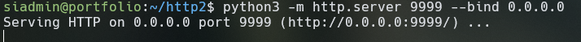


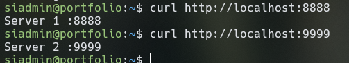


/etc/nginx/conf.d/example-http.conf


```
include /etc/nginx/include/upstream.inc;

server {
   listen       80;

   server_name  example-http.com;

   access_log   /var/log/nginx/example-http.com-access.log;
   error_log    /var/log/nginx/example-http.com-error.log;

   location / {
                proxy_pass      http://example_app;
   }

}
```


/etc/nginx/include/upstream.inc


```
upstream example_app {
        server 127.0.0.1:8888;
        server 127.0.0.1:9999;

}
```


sudo nginx -t

sudo systemctl reload nginx.service

нужно удалить символьную ссылку на дефолтный конфиг, что бы не показывало дефолтную страницу nginx:

sudo rm -f /etc/nginx/sites-enabled/default

sudo nginx -t && sudo systemctl reload nginx

curl -H 'Host: example-http.com' [http://localhost](http://localhost)

 


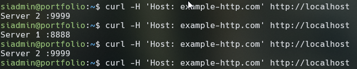


server 127.0.0.1:8888 weight=3;


**Балансировка на 4-ом уровне OSI:**

sudo nano /etc/nginx/nginx.conf


```
stream {
        include /etc/nginx/include/upstream.inc;

        server {
                listen 8080;
                error_log /var/log/nginx/example-tcp-error.log;

                proxy_pass example_app;
        }
}
```


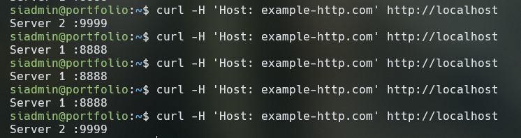


2026/10/16 04:07:54 [emerg] 2110#2110: unknown directive "stream" in /etc/nginx/nginx.conf:63

nginx: configuration file /etc/nginx/nginx.conf test failed

ОШИБКА. Нужно установить модуль Stream

sudo apt install libnginx-mod-stream 

sudo systemctl reload nginx


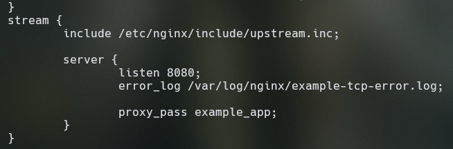


**HAProxy**

**layer 7 балансировка**

sudo apt install haproxy

добавить в файл /etc/haproxy/haproxy.cfg


```
listen stats # веб-страница со статистикой
        bind    :888
        mode    http
        stats   enable
        stats   uri /stats
        stats   refresh 5s
        stats   realm Haproxy\ Statistics

frontend example # секция фронтенд
        mode    http
        bind    :8088
        default_backend web_servers #принимает запрсоы с серверо и перенаправляет их в backend

backend web_servers # секция бэкенд
        mode    http
        balance roundrobin
        option  httpchk
        http-check      send meth GET uri /index.html
        server  s1 127.0.0.1:8888 check
        server  s2 127.0.0.1:9999 check
```


Если нужно очистить левые спецсимволы типа лишних пробелов:

sudo sed -i 's/\x9d//g; s/\xe2\x80\xa8//g; s/\r//g' /etc/haproxy/haproxy.cfg


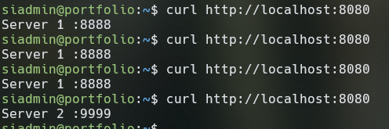


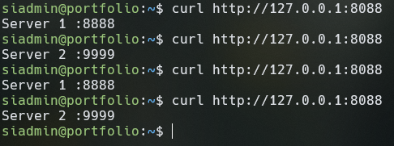


```
 #default_backend        web_servers #принимает запросы с сервера и перенаправляет их в backend
        acl ACL_example.com hdr(host) -i example.com
        use_backend web_servers if ACL_example.com #Запросы принимаются только с example.com

```


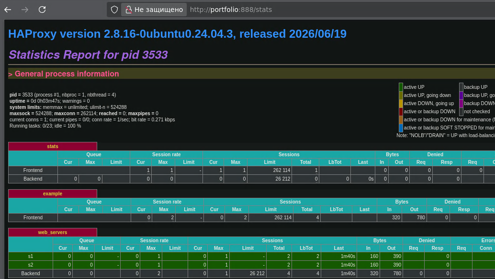


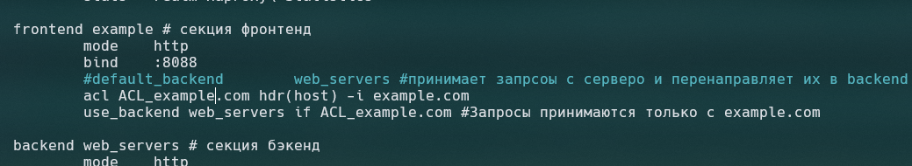


**Layer 4 TCP балансировка **


```
listen web_tcp
        bind :1325
        server s1 127.0.0.1:8888 chek inter 3s
        server s2 127.0.0.1:9999 chek inter 3s
```


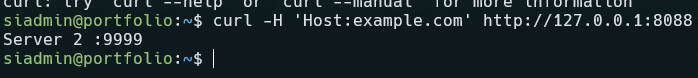


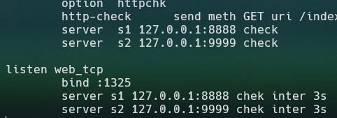


добавилась таблица 


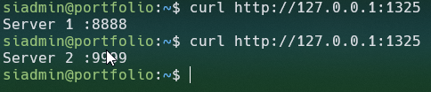


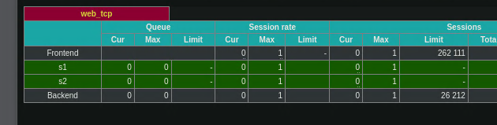


Балансировка на 4-м уровне (L4, транспортный уровень) работает на основе сетевой информации (IP-адреса и TCP/UDP-порты), не заглядывая внутрь пакета. (Nginx (stream), HAProxy (в режиме TCP) )

Балансировка на 7-м уровне (L7, прикладной уровень) полностью разбирает сетевой пакет и принимает решения на основе содержимого протокола (HTTP-заголовки, URL, файлы Cookies, тип запроса).(Nginx (http), HAProxy (режим HTTP) )

**Задание 2 **

Запустите три simple python сервера на своей виртуальной машине на разных портах

Настройте балансировку Weighted Round Robin на 7 уровне, чтобы первый сервер имел вес 2, второй - 3, а третий - 4

HAproxy должен балансировать только тот http-трафик, который адресован домену example.local

На проверку направьте конфигурационный файл haproxy, скриншоты, где видно перенаправление запросов на разные серверы при обращении к HAProxy c использованием домена example.local и без него.


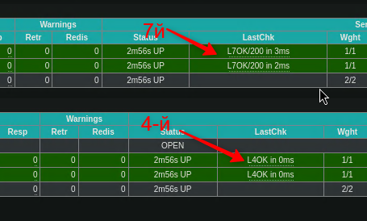


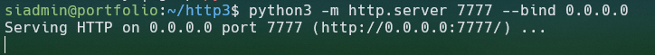


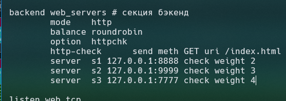


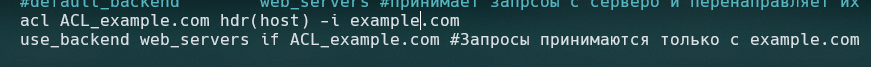


**Задание 3***

Настройте связку HAProxy + Nginx как было показано на лекции.

Настройте Nginx так, чтобы файлы .jpg выдавались самим Nginx (предварительно разместите несколько тестовых картинок в директории /var/www/), а остальные запросы переадресовывались на HAProxy, который в свою очередь переадресовывал их на два Simple Python server.

На проверку направьте конфигурационные файлы nginx, HAProxy, скриншоты с запросами jpg картинок и других файлов на Simple Python Server, демонстрирующие корректную настройку.

**Nginx+HAProxy**

/etc/nginx/conf.d/example-http.conf


```
include /etc/nginx/include/upstream.inc;

server {
   listen       80;

   server_name  example-http.com;

   access_log   /var/log/nginx/example-http.com-access.log;
   error_log    /var/log/nginx/example-http.com-error.log;

   location / {
                proxy_pass      http://localhost:1325;
   }

}
```


 sudo systemctl reload nginx.service

 tail -f /var/log/haproxy.log

curl -H 'Host:example.com' [http://localhost](http://localhost)


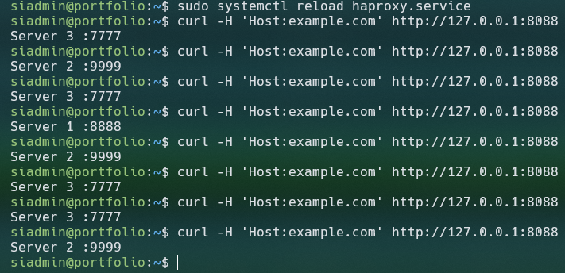


Теперь nginx отправляет запрос HAProxy, а HAProxy выполняет балансировку

**Задание 4***

Запустите 4 simple python сервера на разных портах.

Первые два сервера будут выдавать страницу index.html вашего сайта example1.local (в файле index.html напишите example1.local)

Вторые два сервера будут выдавать страницу index.html вашего сайта example2.local (в файле index.html напишите example2.local)

Настройте два бэкенда HAProxy

Настройте фронтенд HAProxy так, чтобы в зависимости от запрашиваемого сайта example1.local или example2.local запросы перенаправлялись на разные бэкенды HAProxy

На проверку направьте конфигурационный файл HAProxy, скриншоты, демонстрирующие запросы к разным фронтендам и ответам от разных бэкендов.


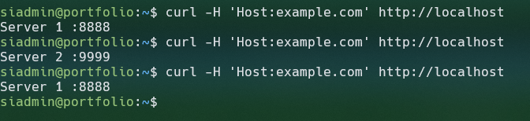


проверка конфигурационного файла 

sudo haproxy -c -f /etc/haproxy/haproxy.cfg


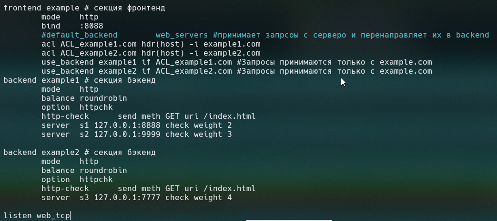


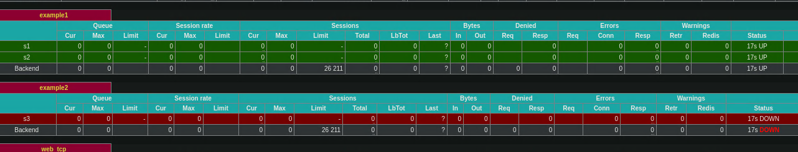


